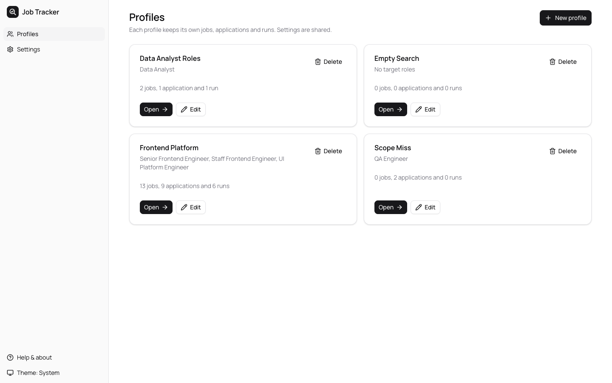
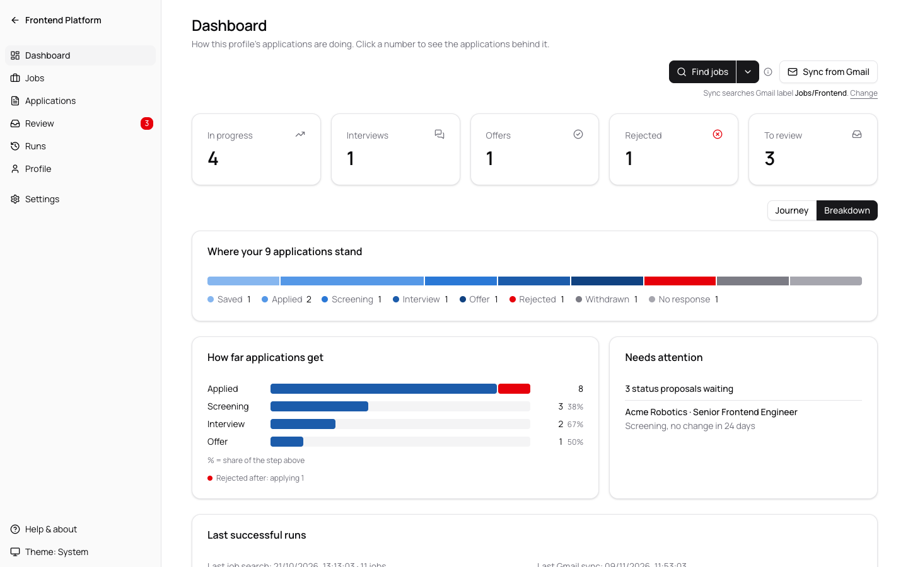
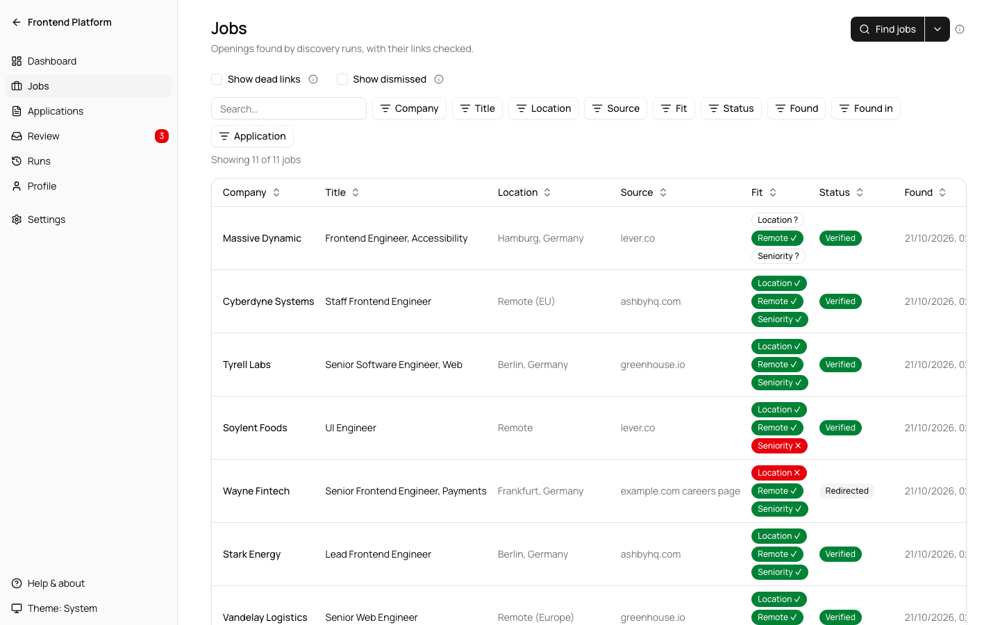
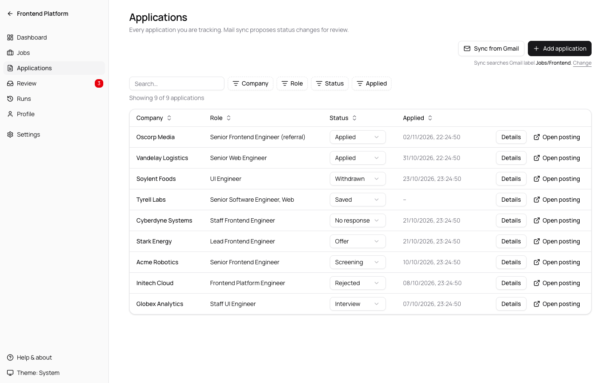
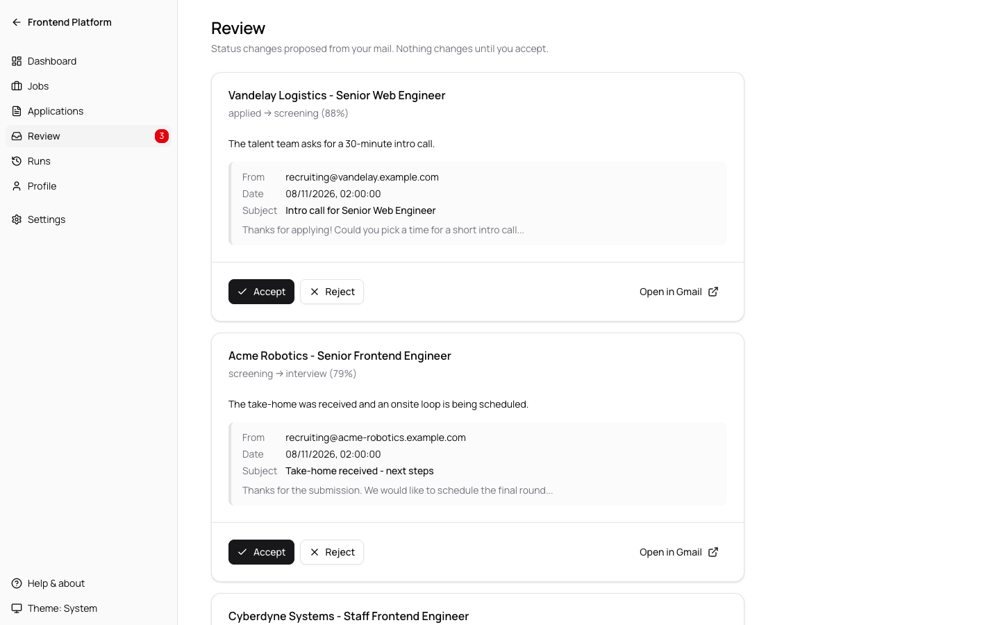
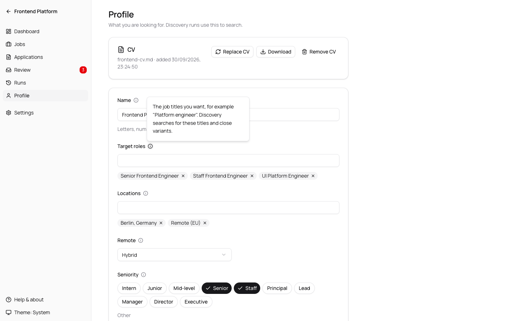
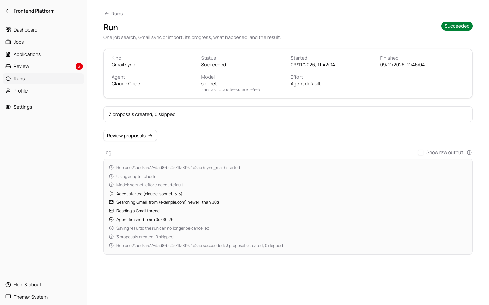
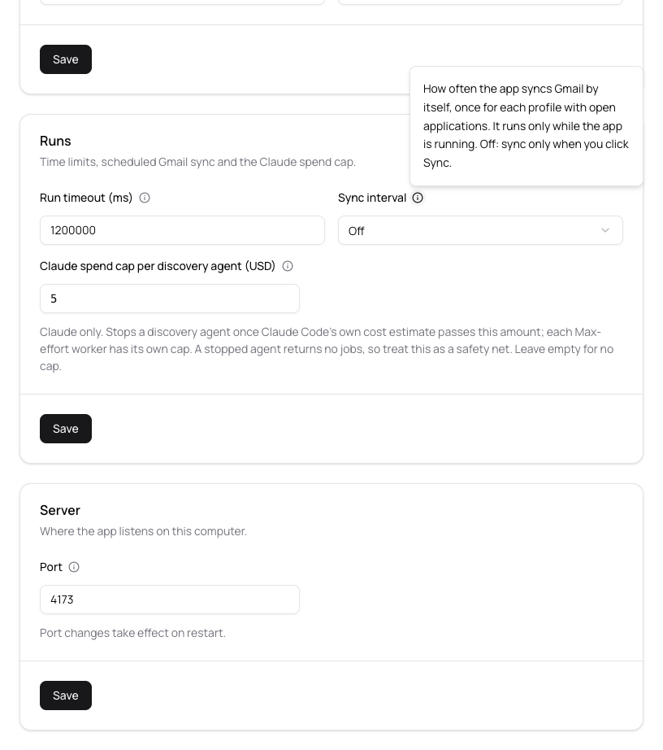

# Job Applications Tracker

A local app that finds job postings matching your profile, checks that the links work, and tracks your applications. It can also read your mailbox through your AI agent and propose status changes. Everything runs on your machine; data is stored in a local SQLite file.

## Install

Requires Node 22 or newer.

```sh
npx job-applications-tracker
```

Or install globally and run the short command:

```sh
npm i -g job-applications-tracker
jobtrack
```

The app starts on `http://127.0.0.1:4173` (or the next free port) and opens your browser.

## First run

1. Setup: pick the agent CLI the app should use (Claude Code, Codex, or a custom command). The app checks that it is installed and, for Claude Code and Codex, whether it is signed in.
2. Profile: the app opens on your profiles. With none yet, it offers two ways to create one: start from your CV (see below), or fill in the form by hand with a name, target roles, locations, remote preference, seniority, keywords and companies to exclude.
3. Find jobs: open the profile and start a discovery run from its Dashboard or Jobs screen, then follow its progress.

Not sure what a field asks for? Click the ⓘ next to it. Every screen also says what it is for under its title.

## Tour

The screenshots use the invented data of `npm run sandbox:mock`.

**Profiles.** One profile per job search, each with its own jobs, applications and runs.



**Dashboard.** How a profile's applications are doing: counts that link to the applications behind them, where every application stands, how far they get, and what needs your attention.



**Jobs.** Openings your agent found, with each link checked by the app and a Fit column for location, remote and seniority. The "Found in" filter shows what one search found.



**Applications.** Everything you applied to, with its status. Sync from Gmail proposes changes; you can also change a status yourself.



**Review.** Status changes proposed from your mail, with the evidence. Nothing changes until you accept.



**Profile.** What you are looking for. The ⓘ next to each field explains what it asks for and how the app uses it.



**Run.** One job search or Gmail sync: what the agent did, in plain words, and the result.



**Settings.** The agent and app settings, shared by all profiles, each with its own help.



## Profiles

- Keep one profile per search, for example "Platform roles" and "Data roles". Each profile has its own jobs, applications, proposals and runs; the agent and app settings are shared.
- Profile names use letters, numbers and single spaces (any alphabet). Each profile gets a short address from its name, for example `/profiles/platform-roles`; renaming a profile changes it, so old bookmarks to that profile stop working.
- Inside a profile, the top left shows its name; click it to go back to all profiles.
- The start screen lists every profile with how many jobs, applications and runs it holds. Open one to work inside it.
- The same job posting can show up in more than one profile.
- Gmail sync runs per profile: it only looks at that profile's open applications. A scheduled sync runs once for each profile that has open applications. To keep two profiles' replies apart, give each one a Gmail label or search (see [How Gmail sync works](#how-gmail-sync-works)).
- Open applications are the ones sync still checks for replies: applied, screening, interview, no response, and offers from the last 30 days. The Dashboard's In progress count is applied, screening and interview only.
- Deleting a profile (Delete on its card, then confirm) removes the profile with its CV, its CV analysis and all its jobs, applications, proposals, status history and run logs. It cannot be undone. While one of its runs is queued or running, cancel the run first.
- Seniority is a set of levels you can toggle (Intern, Junior, Mid-level, Senior, Staff, Principal, Lead, Manager, Director, Executive), plus an Other box for anything else. It is saved as text such as `Senior, Staff`; a value typed before this existed shows up in Other unchanged.
- Upgrading from a version with a single profile keeps your data: the existing profile becomes your first profile, named after its first target role (characters other than letters, numbers and spaces are replaced by spaces).

## Creating a profile from your CV

- On the first-run screen and on New profile, drop your CV on the "Start from your CV" card or choose the file, then click Analyse CV.
- Supported files: PDF, Word (.docx), .txt and .md, up to 10 MB. The app reads the type from the file itself, not its name. Older Word files (.doc), password-protected Office files, OpenDocument, RTF and images are refused with a message.
- The app reads the text out of the file itself and sends only that text to your agent, which uses its own default model and effort. Claude Code gets no tools for this task (no web search, no files, no MCP connectors). Codex runs with web search off and its read-only sandbox, so it can still read files on your computer if it decides to; a custom command runs as you configured it. A scanned PDF has no text to read: fill in the form by hand instead.
- While the agent works, a progress bar shows how long it has been running. You can leave the page: the analysis keeps going and its card waits on the Profiles screen, the first-run screen and New profile. It stops after 5 minutes.
- When it is ready, click Review and create: the profile form opens filled with a suggested name, target roles, locations, remote preference, seniority, keywords and a short summary of your experience in Notes. Excluded companies stay empty. Nothing is saved until you click Create profile.
- One CV analysis for a new profile exists at a time. To analyse another CV, Discard the current one first. Cancel stops a running analysis and deletes the uploaded file.
- If the app stops while the agent is running, the analysis is shown as interrupted after the next start, with Analyse again and Discard. It never restarts on its own.
- The CV stays with the profile you create from it. The Profile screen shows it with Download and Remove CV. Deleting the profile deletes its CV.

## Replacing or adding a CV on a profile

- On the Profile screen, Replace CV (or Add CV when the profile has none) opens the same upload card. Analyse CV runs your agent on the new file, as above.
- Each profile has its own CV analysis, and analyses for different profiles (and for a new profile) run at the same time. A profile can have one at a time: Replace CV comes back once it is saved or discarded. The Profiles screen marks a profile whose analysis is running, ready or failed.
- When it is ready, Review changes opens a side panel that compares the suggestions with what is in the form right now, including edits you have not saved:
  - Replace CV lists only the fields that differ. Add CV lists only the fields the profile leaves empty.
  - Only target roles, locations, remote, seniority and keywords are suggested. Name, excluded companies and notes are never changed.
  - A field the CV says nothing about (no locations, no seniority, remote "Any") is never offered, so a suggestion cannot clear a field or loosen your search.
  - Lists that hold the same items in another order or letter case count as the same.
  - Each field offers Keep current or Use suggested; lists that would gain items also offer Add the new items, which keeps yours and appends the new ones. Replace CV starts every field on Keep current; Add CV starts on Use suggested.
- Apply puts your choices into the form. Nothing is saved until you click Save, which stores the fields and replaces the profile's CV with the new file in one step. If you close the panel or leave the page, the profile and its old CV stay as they were, and the analysis waits on the Profile screen until you save it or discard it.
- Every job search runs for its own profile only. The CV text is not sent to job searches; only the profile fields are, including the Notes summary.

## Cancelling a run

- Runs go one at a time, across all profiles. A Max-effort search runs up to three agents and can take up to about twice the run timeout, and other runs, scheduled Gmail syncs included, wait behind it.
- A queued or running run can be cancelled from its Run page or from the Runs list ("Cancel run", then confirm). The agent is stopped and nothing from that run is saved; the run shows as aborted with "Cancelled by user".
- Once the agent has finished and the app is checking links and saving results, the run can no longer be cancelled: the Run page shows "Saving results…", and a cancel from the Runs list is refused with a message.
- Stopping the agent can take a few seconds; the Run page shows "Cancelling…" meanwhile.

## Model and effort

- Settings → Agent lets you pick the model and the effort level for Claude Code or Codex, separately for discovery and for Gmail sync. Leave them on "Agent default" to use whatever your Claude Code or Codex configuration sets; the app then passes no flag and cannot tell you which model that is.
- Model suggestions: Claude Code offers `fable`, `opus` and `sonnet` (or type a full model id). Codex lists the models from `codex debug models`; if that fails, type the model id.
- Higher effort (`xhigh`, `max`, Codex `ultra`) makes runs slower and can hit the run timeout. Codex `ultra` delegates work to subagents.
- Each run records what it asked for. The Run page shows it; for Claude Code it also shows the model that actually ran. Neither agent reports the effort it used.
- A custom command carries its own flags, so these settings do not apply to it.

## How discovery works

- The agent searches the web for postings that match your profile and returns structured results. It is told to spend about 10 minutes, prefer employer and ATS (applicant tracking system) pages, read a company's public Greenhouse or Lever job list instead of opening single postings when it can, confirm each posting at most once, and return up to 30 jobs, stopping at about 10 strong matches. Fewer is fine; it is told not to pad the list. A run that exceeds the run timeout in Settings (default 20 minutes) is stopped and saves nothing.
- For each job the agent also says whether it matches your locations, remote preference and seniority. The Jobs screen shows this in the Fit column (✓ matches, ✗ does not match, ? not stated). It never hides a job.
- On Claude Code, discovery runs load only the tools allowed for discovery and skip your MCP servers unless one of those tools is an MCP tool. Loading every MCP server can add hundreds of thousands of tokens to each run. They also stop when Claude Code's own cost estimate reaches the spend cap in Settings → Runs (default $5 per agent; empty means no cap). A stopped agent returns no jobs, so treat the cap as a safety net. On Codex, discovery uses live web search.

## Max-effort search

- On the Dashboard and Jobs screens, "Find jobs" is a split button: the arrow picks Default or Max effort, and the button then reads "Find jobs" or "Find jobs with max effort". It starts on Default every time the page loads. Max effort runs five searches by source instead of one: Greenhouse, Lever, Ashby, other ATS and careers pages, and remote and niche job boards. Up to three run at a time, and each gets the full run timeout. The app merges the results, removes duplicates and checks every link as usual.
- It uses several times the tokens of a normal search and can use up your Claude Code or Codex plan's limits. A dialog says so, with the time limit, the spend cap (Claude Code only) and what your last complete Max-effort search used, and nothing starts until you confirm. The app cannot see your bill, so it shows no cost estimate up front.
- If some searches fail, the jobs from the others are kept and the run summary says how many failed. The run fails only when all five fail.
- The Run page shows what each discovery run used, as the agent reported it: Claude Code's estimated cost (at list price, not your bill) and tokens, or Codex's tokens. A search that times out or is cancelled reports nothing, or for Max effort only what its finished searches used, so the real use can be higher. The Max-effort dialog quotes only your last complete Max-effort search.
- The app then checks every link itself (it does not trust the agent) and shows a badge on each job:
  - **Verified**: the page loaded.
  - **Redirected**: the link led somewhere else; the final address is stored.
  - **Could not verify**: the check failed or timed out (network error, site blocking automated requests). The job is kept.
  - **Dead link**: the page is gone, or the link is Greenhouse's "posting closed" page (the company's job board with `error=true`). These jobs are hidden by default.
- Clicking Save or Mark applied twice on a job never creates a duplicate application.
- Duplicates are skipped across runs of the same profile: jobs are matched by canonical URL, or by company, title and location when there is no usable URL.
- Each job belongs to the search that first found it. On the Jobs page, the "Found in" filter lists your searches by start time and mode, and "View jobs" on a successful search opens the Jobs page filtered to it. A job a later search finds again shows "Seen again" and the date under its Found date, and takes that search's link check when the job's site answered; a timeout or network error keeps the earlier result, so a connection problem never hides a job. A job whose link now redirects elsewhere, often a closed posting sent to the company's job board, is matched to the job you already have and shows Redirected.

## How Gmail sync works

- A sync run asks your agent to search your mailbox for messages about the jobs you applied to.
- Results appear as proposals, for example "move this application to interview". Nothing changes until you accept a proposal; you can also reject it.
- Each proposal shows its evidence (sender, date, subject, snippet) and a link to the message so you can verify it.
- Sync can run on demand from a profile, or on a schedule (Settings). Scheduled sync only runs while the app is running, once per profile with open applications.
- Open applications are the ones sync still checks for replies: applied, screening, interview, no response, and offers from the last 30 days. The Dashboard's In progress count is applied, screening and interview only.
- By default the agent searches for mail from the companies you applied to and from known job-board senders (Greenhouse, Lever, and so on). Profiles share one mailbox, so two profiles that applied to the same company, or through the same job board, can pick up each other's replies.
- To tell the agent where a profile's mail is, open the profile and fill in **Gmail sync**:
  - **Gmail label** (the default): the label name as Gmail shows it, for example `Jobs/Frontend`. Gmail has no folders; labels are its folders. Create the label in Gmail and a Gmail filter that applies it to the replies, for example to mail sent to the address you applied with. The app turns the name into the search `label:Jobs-Frontend` (each space or other blank character and each `/` becomes `-`, which is how Gmail matches label names). A label name cannot contain `"`, brackets (`( ) { }`) or invisible characters, and cannot start with `label:`; for those, use a custom search.
  - **Custom Gmail search (advanced)**: any [Gmail search](https://support.google.com/mail/answer/7190), used as typed, for example `label:jobs-frontend OR to:you+frontend@gmail.com`. A plus address (`you+frontend@gmail.com`) is a handy way to tell profiles apart: apply with it, and replies arrive at it.
  - Either way the value is one line of at most 300 characters. Leave it empty to keep the company and job-board search.
- When a profile has a label or search, the agent reads only the mail that matches it, from any sender, including recruiters who write from a personal address. Mail your Gmail filter did not catch is not seen.
- The agent also reports how much mail the label or search matches on its own. When it matches none, the run still succeeds, but its result ends with "the Gmail scope matched no mail": check the label name or the search on the Profile page.
- The Dashboard and the Applications page show what Sync from Gmail searches, under the buttons, with a Change link to the Profile page.
- The app never labels, moves or changes mail; set up the labels and Gmail filters yourself.

## Gmail access for other agents

Sync needs a Gmail tool in your agent.

- **Claude Code**: uses the claude.ai Gmail connector. Connect Gmail in your claude.ai account. The tools the sync run may call are listed in Settings as `allowed_tools_sync`; the default is:
  `mcp__claude_ai_Gmail__search_threads,mcp__claude_ai_Gmail__get_thread,mcp__claude_ai_Gmail__get_message`
- **Codex and custom commands**: configure a Gmail MCP server in that agent yourself. The app cannot do it for you.
- If no Gmail tool is available, the sync run fails with: `Your agent has no Gmail tool. See the setup guide in Settings.`

## Security

- The server binds to `127.0.0.1` only, so other machines cannot reach it.
- There is no authentication, on purpose: it is a single-user local tool.
- Requests must carry a loopback `Host` header, and browser requests with a foreign `Origin` are rejected. This stops other websites from using the API through your browser.
- The agent runs with the permission mode and tool allow-list shown in Settings (read-only sandbox by default; Gmail tools limited to search and read). On Claude Code the app also loads only your user-level Claude settings, leaves out your personal `CLAUDE.md`, auto-memory and hooks, and blocks subagents. On Codex (tested with codex-cli 0.163.0 or newer) it turns subagents off, but Codex still reads your personal `~/.codex/AGENTS.md`: Codex has no switch for it, and running it from a separate Codex home could leave your normal Codex sign-in on an old token.
- The app never applies to jobs, sends mail, or modifies labels or messages.

## Data and logs

- Data lives in the data directory, `~/.job-applications-tracker/` unless you choose another (see [Choosing the data directory](#choosing-the-data-directory)):
  - `data.db`: profiles, jobs, applications, proposals, settings.
  - `runs/`: one log per run, plus a folder per run with the prompt, schema and agent output files.
  - `profiles/<profile id>/`: the CV kept with a profile (`cv.pdf`, `cv.docx`, `cv.txt` or `cv.md`) and the text read from it (`cv-text.txt`).
  - `cv-analyses/<id>/`: the uploaded CV and its text while an analysis is running or waiting for review, for a new profile or for an existing one. The agent's prompt, which holds the CV text, is deleted as soon as the agent finishes.
- Purge run logs from Settings. This deletes the run logs and the per-run prompt and output files of every run that is not queued or running.
- Run logs can contain agent output, including mail snippets. Do not share them.
- A CV is personal data and stays on your disk. Remove CV on the Profile screen, Discard on an analysis, and deleting a profile each delete the file and its text.

## Choosing the data directory

- The first time you start `jobtrack` in a terminal, it asks where to keep your data. Press Enter for `~/.job-applications-tracker`, or type or drag in another folder (`~`, quotes and escaped spaces work). The folder is created if needed.
- Your answer is saved in `~/.config/job-applications-tracker/config.json` (the same path on macOS, Linux and Windows) and used on every later start. You are not asked again.
- You are not asked when:
  - the start is not in a terminal (a script or CI): the default folder is used and nothing is saved;
  - `--data-dir` or `JOBTRACK_DATA_DIR` is set;
  - you already have data in `~/.job-applications-tracker`.
- Change it later with the `config` command. Changes apply from the next start:

  ```
  jobtrack config get data-dir           # the folder in use and where it comes from
  jobtrack config set data-dir <path>    # use another folder (created if missing)
  jobtrack config unset data-dir         # go back to ~/.job-applications-tracker
  ```

- Which folder wins: `--data-dir`, then `JOBTRACK_DATA_DIR`, then the config file, then `~/.job-applications-tracker`.
- If the saved folder is missing (deleted, or on a drive that is not connected), the app stops with an error instead of starting empty. Reconnect the drive, or run `config set` or `config unset`.
- To start over with no data, stop the app, delete the data folder and run `jobtrack config unset data-dir`. Deleting the folder alone is not enough once a folder is saved, even the default one.
- Your data is never moved for you. To move it:
  1. Stop the app.
  2. Move the whole folder to its new place, for example `mv ~/.job-applications-tracker ~/Documents/jobs`. Move the folder itself, so the database's `data.db-wal` and `data.db-shm` files go with it.
  3. Run `jobtrack config set data-dir ~/Documents/jobs`.
- Avoid folders synced by iCloud Drive, Dropbox or similar: syncing the database while the app is running can corrupt it.

## Moving to another device

All your data is in the data folder, so moving to another computer means copying that folder.

1. On the old device, stop the app (Ctrl+C in its terminal), so everything is written to disk.
2. Copy the whole data folder. `jobtrack config get data-dir` shows where it is; by default it is `~/.job-applications-tracker`. Copy the folder itself, so `data.db-wal` and `data.db-shm` go with `data.db`.
3. On the new device, install the same version of the app or a newer one (`jobtrack --version` shows it). An older version opens a newer database without a warning and may mishandle it.
4. Put the folder in place before you start the app there:
   - at `~/.job-applications-tracker`, the default: the app finds it and does not ask where to keep data;
   - anywhere else: run `jobtrack config set data-dir <path>`.

   If the app already ran on the new device, stop it first and replace its data folder, or point it at the copy with `config set`.
5. Install your agent CLI on the new device and sign in. Claude Code's Gmail connector belongs to your claude.ai account; for Codex or a custom command, set up its Gmail MCP server again.
6. Start the app and open Settings → Agent. The agent choice, custom command, permissions and port came with the data; a custom command may point to paths that do not exist on this device.

Keep in mind:

- The database stores file names, not full paths, so the folder works wherever you put it.
- The folder holds your CVs, and run logs can hold mail snippets. Move it over a channel you trust, such as your own drive, and delete copies you no longer need.
- Use the app on one device at a time. Two copies never merge: changes made on the old device after the copy stay there.

## Command line

```
jobtrack [options]
  --port <n>        port to listen on (default 4173; 0 picks a free port)
  --data-dir <dir>  where to store data (this run only; not saved)
  --no-open         do not open the browser
  --help            show help
  --version         show version

jobtrack config get data-dir
jobtrack config set data-dir <path>
jobtrack config unset data-dir
```

`JOBTRACK_DATA_DIR` sets the data directory; `--data-dir` takes precedence. Both win over the saved folder.

## Known limitations

- Windows: agent CLIs installed by npm are resolved through their `.cmd` shims and started as `node <cli.js>`; this path is covered by tests with simulated shims only and has not been exercised on a real Windows machine.
- On POSIX a timeout or abort kills the agent's whole process group; on Windows the process tree is killed with `taskkill /T`. A helper that ignores SIGTERM is only force-killed if the agent itself is still running when the 5 s escalation fires.
- A custom command cannot read Gmail unless that agent has a Gmail tool.

## Interface

- The Dashboard shows In progress, Interviews, Offers, Rejected and To review tiles (each number links to the rows behind it), a bar of every status with a legend (Rejected in red, as in the status badges), how far applications get (Applied → Screening → Interview → Offer, with the share of the step above, and in red how many were rejected after each step), and applications with no change in 14 days ("Applied 20 days ago, no reply"; five shown, "Show 3 more" for the rest). A profile with no applications shows "No applications yet". Chart tooltips appear on hover; the legend links are the keyboard route to the same counts.
- On wide windows (1280 px or more) the Dashboard offers two views under the tiles: Journey, a flow graph where applications move from Applied to Offer and those that stop at a stage branch off (waiting, rejected, no response, withdrawn), and Breakdown, the bar and funnel described above. Journey is the default from 10 sent applications; your choice is remembered in the browser.
- Every form field has an ⓘ button next to its label: click it (or press Enter on it) to see what the field asks for and how the app uses it. Esc or a click elsewhere closes it. Every screen says what it is for under its title.
- Help & about, at the bottom of the sidebar, shows the app version and links to this documentation, the GitHub repository (where you can star the project) and the issue tracker. The links open in a new tab; the app never contacts GitHub by itself.
- Light, dark, or follow your system: pick it from the theme menu at the bottom of the sidebar. The choice is remembered in this browser for the port the app runs on; a different port starts from the system setting again.
- Purging run logs, dismissing a job, cancelling a run, cancelling or discarding a CV analysis and removing a CV ask for confirmation first.
- The Jobs, Applications and Runs tables sort by any column: click a header for ascending, again for descending, and a third time for the default newest-first order. A search box and one filter per column sit above each table: tick values (with counts), type text a column must contain, or pick a date range on a calendar (Jobs by Found date, Applications by Applied date, Runs by Started or Finished date; rows without a date drop out); the Jobs table also filters by the search that found each job. Reset clears search and filters. The view is kept in the page address, so it survives opening an application or run and coming back. The Runs table loads the newest 200 runs.
- The run log shows what the agent is doing in plain words (web searches, pages opened, Gmail reads, errors, a finish summary). Tick "Show raw output" to see everything the agent printed, exactly as saved.
- Desktop browsers only. The interface needs Chrome or Edge 111+, Safari 16.4+, or Firefox 128+.

## Development

```sh
npm install
npm test
npm run build
npm run dev:ui      # Vite dev server; proxies the API to port 4173
node bin/jobtrack.js --no-open --data-dir .tmp/dev
npm run sandbox     # build, then run the app on a throwaway data dir (.tmp/sandbox)
npm run sandbox:mock  # build, reseed .tmp/sandbox-mock with mock data, then run the app on it
```

Every pull request and every push to `main` runs `npm run typecheck` and `npm test` on GitHub Actions with Node 22 and the current Node LTS.

`npm run sandbox` never touches your real data in `~/.job-applications-tracker`. Delete `.tmp/sandbox` to start fresh. Extra flags go after `--`, for example `npm run sandbox -- --no-open --port 5000`.

`npm run sandbox:mock` is for trying the UI. It deletes `.tmp/sandbox-mock` and fills it again on every start, so changes made in the UI last until the next start. The data is invented: a profile with a CV, jobs, applications in every status, proposals and past runs, and the Gmail label `Jobs/Frontend`; a sparse profile with a custom Gmail search; an empty one; and "Scope Miss", whose label `NoMatch` the mock agent reports as matching no mail, so its Sync shows "the Gmail scope matched no mail". The mock does the same for any label or search containing `nomatch`. The agent is set to a mock command (`scripts/sandbox-mock/mock-agent.mjs`) that returns canned results after a few seconds, so Find jobs, Sync mail and CV analysis never search the web, read your Gmail or start Claude Code or Codex. The app still checks job links over the network: the mock links point at `example.com`, so without a connection new jobs show up as dead or unverified. Changing the agent in Settings switches the sandbox to your real agent. Do not pass `--data-dir` after `--`: the mock data is always written to `.tmp/sandbox-mock`, and another folder would run the app on that folder's own data and agent instead.

The UI is built with [shadcn/ui](https://ui.shadcn.com). Component sources live in `src/ui/components/ui/` and are owned by this repo. Add one with:

```sh
npx shadcn@latest add <component>
```

The CLI adds a stray `cn` package and a `cn` placeholder import; see `AGENTS.md` for the fix-up steps.

## License

MIT. See `LICENSE`.
